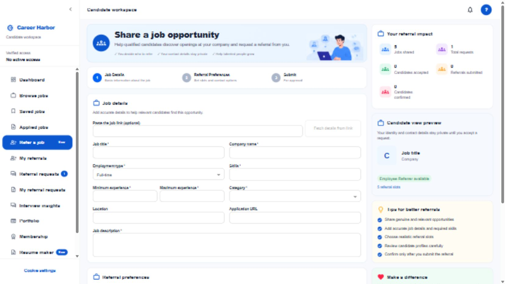

# CareerHarbor Phase-1 referral frontend completion report

## 1. Implementation
Implemented the opportunity creation, owner dashboard, request inbox, candidate review, acceptance/rejection, manual referral completion, submitted/confirmed states, and candidate request/contact/receipt flows using the existing dashboard shell, MUI theme, authentication and RTK Query infrastructure. Backend contracts were inspected in the separate .NET repository and left unchanged. All displayed lifecycle facts come from backend responses; no employer ATS events are inferred.

## 2. Screens
- Refer a Job: job URL extraction, validated job fields, skill chips, slots, profile-based contact sharing, candidate preview, impact and guidance.
- Opportunity submission success: persisted owner summary, actual approval status, contact preferences and next actions.
- My Referral Jobs: real metrics, approval filters, search/pagination, request totals, server capacity and scoped request navigation.
- Global/scoped Referral Requests: complete paginated inbox, lifecycle filters, candidate summaries and pending actions.
- Candidate request detail: authorized candidate metadata, explicit resume download, accept/reject and accepted state.
- Complete Referral: manual employer referral instructions, acknowledgements and confirmation modal.
- Referral Submitted / Candidate Confirmed / Not Received states: backend-derived status and timestamps.
- Candidate My Referral Requests/detail: accepted-connection quota, protected contact, confirm receipt/report not received.
- Public referral cards: generic referrer label, server remaining slots and request dialog.

Approved illustration artwork was cropped from the supplied references. Cards, gradients, compact fields, stepper and status colors follow those references while preserving the existing application header/sidebar. Pixel-perfect equivalence is not claimed where the shared shell or backend-supported fields differ.

## 3. Routes
Existing `/dashboard/refer-a-job`, `/dashboard/referrals` and legacy referral contact routes remain available. Added:
- `/dashboard/referrals/:referralId/submitted`
- `/dashboard/referrals/:referralId/requests`
- `/dashboard/referral-requests`
- `/dashboard/referral-requests/:requestId`
- `/dashboard/referral-requests/:requestId/complete`
- `/dashboard/referral-requests/:requestId/submitted`
- `/dashboard/my-referral-requests`
- `/dashboard/my-referral-requests/:requestId`

All use the existing authenticated candidate workspace. Referral requests remain separate from normal applications and never redirect to Applied Jobs.

## 4. Files added
Under `src/features/referrals/`: `types/marketplaceModels.ts`, `api/marketplaceApi.ts`, `api/marketplaceFixtures.ts` (test fixtures only), `api/marketplaceApi.test.ts`, `components/MarketplaceUI.tsx`, `components/OpportunityCapacity.tsx`, `components/PendingRequestActions.tsx`, `components/ReferralStepper.tsx`.

Under `src/pages/`: `ReferralMarketplacePages.tsx`, `CandidateReferralRequestsPage.tsx`, `referralMarketplace.test.tsx`.

Artwork: `public/images/referrals/{share,success,complete}.png`. Report and QA evidence: this document, `artifacts/referral-*-results.json`, desktop/mobile screenshots. Temporary preview app and extraction scripts were removed.

## 5. Files modified
- `src/components/navigation/DashboardLayoutShell.tsx`
- `src/features/referrals/api/referralsApi.ts` and `.test.ts`
- `src/features/referrals/components/ReferralJobCard.tsx`, `ReferralJobsSection.tsx` and `.test.ts`, `ReferralPremiumBanner.tsx`
- `src/features/referrals/types/referralModels.ts`
- `src/layouts/UserDashboardLayout.tsx` and `.test.ts`, `candidateNavigation.ts`
- `src/pages/AllReferralsPage.tsx`, `ReferAJobPage.tsx`, `ReferralContactDetailsPage.tsx`
- `src/pages/PaymentPage.tsx`, `src/pages/home/LandingSections.tsx` (referral copy only)
- `src/routes/routeConfig.tsx`, `src/store/store.test.ts`

## 6. Endpoints by screen
| Screen | Backend endpoints |
|---|---|
| Create opportunity | Existing URL extraction/category/profile APIs; `POST /referrals`; `GET /referrer/metrics` |
| Submission success / owner dashboard | `GET /referrals/mine`, `GET /referrer/metrics`, `GET /referrer/referral-requests` |
| Request inbox | `GET /referrer/referral-requests`; `POST /referrer/referral-requests/{id}/accept` or `/reject` |
| Referrer detail / completion | `GET /referrer/referral-requests/{id}`; explicit `GET .../{id}/resume`; accept/reject; `POST .../{id}/mark-referred` |
| Public opportunities | `GET /referrals/public`; `POST /referrals/{referralId}/requests` |
| Candidate requests/detail | `GET /referral-requests/mine`, `GET /referral-requests/{id}` |
| Protected contact | `GET /referral-requests/{id}/contact`, mounted only for authorized accepted/submitted/confirmed requests |
| Candidate receipt actions | `POST /referral-requests/{id}/confirm`, `POST .../{id}/not-received` |

Request bodies match inspected contracts. Creation sends `jobDetails`, `sourceUrl`, sharing booleans and `referralSlots`; requests send `candidateMessage`; rejection sends `reason: null`; completion sends `referralSubmissionReference: null`. Unsupported properties are not sent. Mutations invalidate request/metrics/owner/public capacity caches even on conflicts; successful actions refresh notifications. No optimistic acceptance or invented capacity decrement occurs.

## 7. Legacy behavior removed
Public real names/photos/tenure and unsupported match scores were removed. Browse cards now create requests rather than unlocking contact. The legacy contact route explains the request workflow and does not fetch contact or trigger payment. Legacy unlock API remains only for compatibility, with request-required behavior tested; production UI does not invoke it. Payment/membership copy no longer promises immediate contact disclosure.

## 8. Privacy
Public types/cards use `referrerLabel` only. Protected contact requires both backend `canViewContact` and an accepted/submitted/confirmed request state; the backend remains responsible for active membership and authorization. Protected caches are short-lived and participate in existing logout resets. No contact is stored in localStorage. Referrer detail uses authorized candidate card data only. Resume download is an explicit authenticated request; no raw storage URL is exposed. Pending resume access is allowed by the inspected backend contract, independently of protected contact acceptance.

## 9. Responsive behavior
Main/sidebar columns collapse on narrow screens, form fields and actions wrap, cards and status steps remain readable, and dialogs remain accessible. Browser QA inspected the final desktop form at 1672 × 941 and mobile form/completion at 390 × 844. Mobile document width equaled its client width (375 px after scrollbar), with no horizontal overflow. Keyboard-focus outlines, labelled fields, validation feedback and dialog confirmation controls are included. Mobile screenshot predates the final compact external-label styling; desktop screenshot captures it.

## 10. Tests added/updated
Focused coverage includes real RTK Query endpoint/body wiring, complete pagination and partial-page failures, invalidation/conflicts, denied contact stripping, public identity suppression, creation validation, skills, navigation, quota errors, acceptance/rejection, completion confirmations, authorized contact mounting and on-demand resume authorization. Existing store/logout and sidebar tests were updated for the new contracts/navigation.

## 11. Focused results
45 / 45 focused tests passed (`artifacts/referral-focused-results.json`). Scoped ESLint passed. Production TypeScript/Vite build passed, with existing SignalR annotation and bundle-size warnings. `git diff --check` passed. Browser testing used a temporary local fixture adapter, not a live backend; no end-to-end production integration is claimed.

## 12. Existing regressions
Broader regression selection: 140 / 146 passed. Five failures concern unchanged admin navigation order, two pre-existing Career Guidance navigation expectations, and two candidate search URL/filter-count expectations. The sixth was a checkout timeout during concurrent validation; standalone checkout rerun passed all 8 tests (`artifacts/referral-checkout-results.json`). The underlying unrelated navigation/search implementations were not changed. Existing payment/job/Interview Insights behavior was included in the regression selection.

## 13. Backend gaps
- Owner opportunity DTO lacks full skills, description, employment type, experience, application URL and slug. Success reloads show only authoritative available details; missing data is not fabricated.
- No opportunity edit/close/draft APIs, contact overrides, personal note, company role or proof attachment contracts.
- No per-opportunity metrics or referralId request filter. The frontend fetches every inbox page before deriving scoped counts; a failed page prevents partial data from masquerading as complete. This costs O(total requests) and is not an atomic cross-page snapshot during concurrent changes. Backend capacity always wins.
- Candidate card lacks full-profile/contact fields; no unsupported full-profile endpoint is invented.
- Backend migration was not applied, so live integration remains unverified.

## 14. Intentionally omitted UI
Unsupported edit, closed/draft tabs, monthly deltas, company-role/note/contact-override controls, proof uploads, automatic submission to employers and unsupported candidate profile/contact fields. The notes/upload area in the screenshot cannot truthfully persist with the current contract. Application/job detail fields absent from owner responses are omitted on reload.

## 15. Deferred
Employer verification, points/rewards, cancel-request flow, ATS/interview/offer/hire progression, employer portal integration, unsupported edits/attachments and real-backend end-to-end validation. These are not represented as implemented facts.

## 16. Manual integration checklist
Run against an approved disposable backend with the required schema already prepared:
1. Create an opportunity with valid fields/contact selections; verify pending approval, reload success, and clean Share Another Job form.
2. Verify public pending/rejected opportunities are unavailable; approved cards never expose owner identity.
3. Create a candidate request; verify accepted quota is unchanged, duplicate/full/access errors surface without optimistic changes.
4. Compare global and scoped inboxes, pagination/search/status filters, real metrics and capacity.
5. Download a resume explicitly; test backend 403 and rejected/expired restrictions.
6. Reject with confirmation; verify list/detail/cache refresh. Accept separately; verify backend quota/capacity and conflict handling across two sessions.
7. Before acceptance and with payment alone, verify no protected contact request occurs. Test accepted authorization, inactive membership, logout and a different user.
8. Complete the referral externally; tick acknowledgements, cancel then confirm modal; verify only confirmed action calls mark-referred and navigates to submitted state.
9. Confirm receipt or report not received as the candidate; verify server timestamps/status and refreshed owner metrics.
10. Test narrow viewport, keyboard navigation, errors, empty/loading states and all existing normal application/payment flows.

## Explicit assertions
- No real referrer identity is publicly exposed by the implemented frontend.
- Payment alone does not reveal contact; acceptance plus backend authorization is required.
- Request creation does not consume referral quota; acceptance is backend-controlled and consumes the accepted-connection allowance.
- Frontend shows no employer-side hiring statuses.
- ₹99 pricing, normal daily quota and payment behavior were not changed; only misleading referral copy was corrected.
- No production database was contacted, no migration applied, no deployment performed, and no commit/push performed.

